# 電極棋局 Electrode Gambit

**[開啟主持機](https://weipingwang1995.github.io/biomicrofluidic-board-game/)**　｜　**[原理短片](https://weipingwang1995.github.io/biomicrofluidic-board-game/videos.html)**

生物微流體課程的教育桌遊。每位玩家經營一片 EWOD 晶片，用答題賺來的電荷，把液滴一路送到光學檢測站。

- **人數**：5 人，另需 1 位主持人（也可以由其中一人兼任，但會看到答案）
- **時間**：6 回合，預估約 35 分鐘（尚未經真人試玩驗證）
- **類型**：結合知識問答的資源管理棋盤遊戲
- **版本**：基本版（全員同任務，建議先玩）、進階版（加入角色、晶片選擇、事件卡）

玩家在桌上用實體棋盤、棋子、答題板和答題旗，主持人用一台手機或電腦操作主持機。主持機負責出題、倒數和記錄電荷、分數，**但不知道棋子在哪一格**，走到哪裡要看桌上的棋盤。

## 快速開始

1. 列印 [`print/electrode-gambit-prototype.pdf`](print/electrode-gambit-prototype.pdf)，剪下棋子和答題旗。
2. 開啟[主持機](https://weipingwang1995.github.io/biomicrofluidic-board-game/)。
3. 在開局畫面輸入姓名、按「抽籤換座位」，再按「開始遊戲」。
4. 照[每回合流程](#每回合流程)一直按下去，6 回合後主持機會顯示排名和題目回顧。

## 準備道具

| 道具 | 數量 | 怎麼準備 | 基本版 | 進階版 |
|---|---|---|---|---|
| 棋盤 | 1 張 | PDF 第 1 頁，用 A3 列印 | 要 | 要 |
| 棋子 | 5 個 | PDF 第 5 頁，沿虛線剪下，可貼在硬幣或瓶蓋上 | 要 | 要 |
| 主持人小卡 | 1 張 | PDF 第 3 頁 | 要 | 基本版內容可參考 |
| 答題板 | 1 張 | PDF 第 4 頁，A4 分成 A 到 D 四格 | 要 | 要 |
| 答題旗 | 5 張 | PDF 第 5 頁，剪下後沿虛線對折 | 要 | 要 |
| 基本版任務卡 | 1 張 | PDF 第 5 頁，和棋子同一頁 | 要 | 不用 |
| 角色與晶片卡 | 9 張 | PDF 第 7 頁 | 不用 | 要 |
| 進階版任務卡 | 6 張 | PDF 第 8 頁 | 不用 | 要 |
| 事件卡 | 12 張 | PDF 第 9 頁 | 不用 | 備援用 |
| 備援題本 | 3 頁 | PDF 第 10 到 12 頁 | 建議 | 建議 |
| 骰子 | 1 顆 | 自備 | 不用 | 「液滴體積誤差」事件要用 |
| 主持機 | 1 台 | 手機、平板或電腦 | 要 | 要 |

規則摘要在 PDF 第 2 頁（基本版）和第 6 頁（進階版）。主持人小卡用顏色和標題分區，說明規則時可以快速查看。

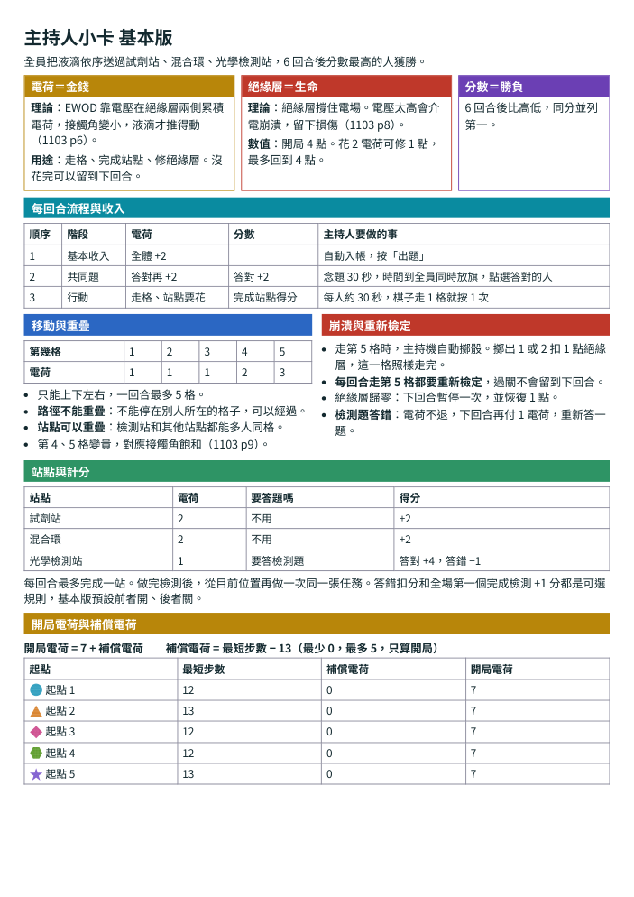

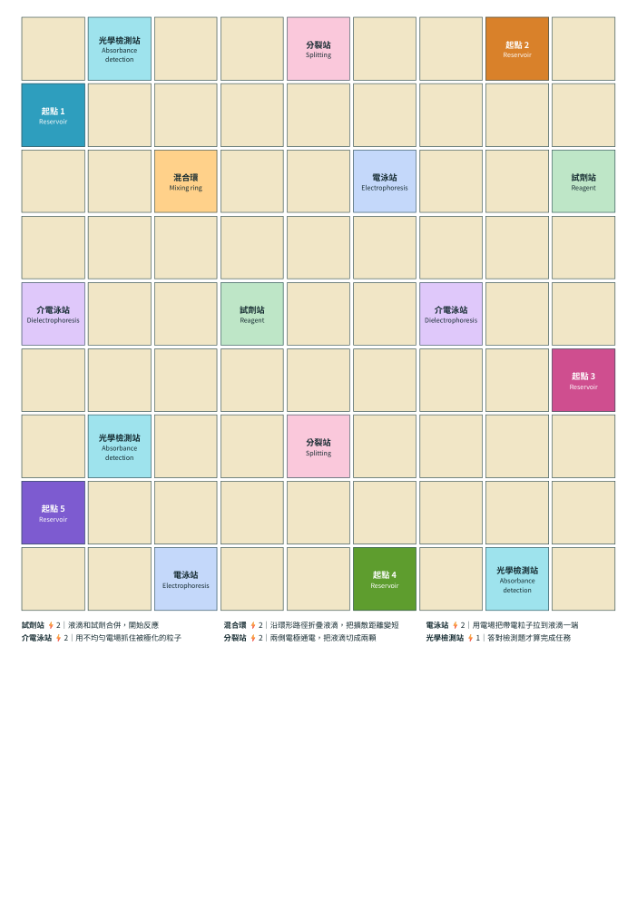

## 卡牌怎麼用

### 棋子

每位玩家的棋子、起點和答題旗都用同一組顏色、底紋和形狀，黑白列印時也分得出來。

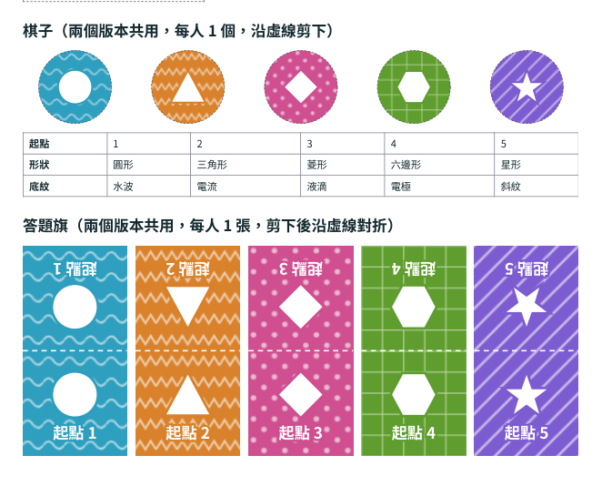

### 答題板和答題旗

答題板放在桌子中間，全桌共用一張。每人拿一張和自己起點同色的答題旗，棋子則留在棋盤上標記液滴位置。

倒數時先想好答案，**時間到大家同時把旗子放到 A、B、C 或 D 格**，放下就不能改。主持人看旗子的顏色和位置，把答對的人點進主持機。

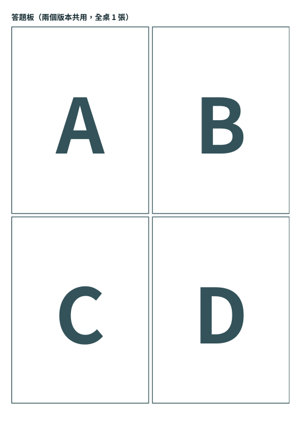

### 任務卡

任務卡寫著要依序完成的站點。基本版全員做同一張「葡萄糖比色檢測」，放在桌子中央就好：

```
試劑站（2 電荷） → 混合環（2 電荷） → 光學檢測站（1 電荷＋答題）
```

進階版由主持機分配任務，完成後自動換下一張。主持人把對應的卡放到玩家面前，方便玩家查看。

### 角色與晶片卡（進階版）

開局時每人選 1 個不重複的角色、1 種架構和 1 種絕緣層，在主持機選好後，把對應的卡放在自己面前。能力由主持機自動計算，卡片只是提醒。

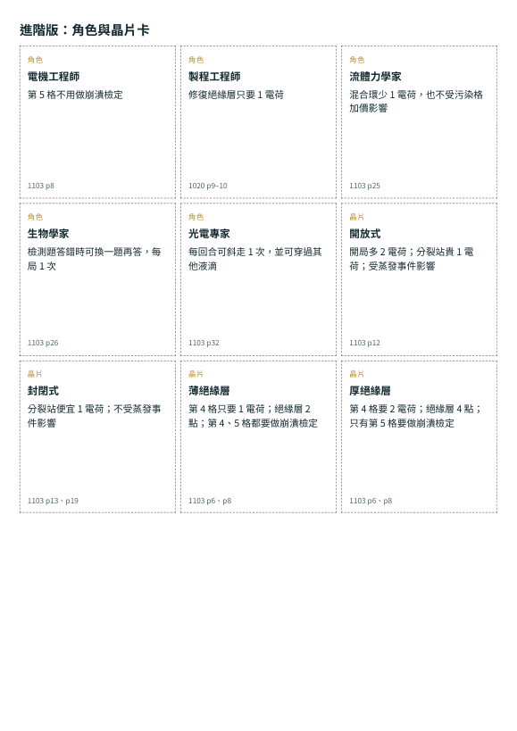

### 事件卡（進階版）

主持機每回合會自動翻一張事件並套用效果，**平常不需要實體卡**。主持機不能用時才用這疊卡，每回合抽一張，由主持人手動處理。「液滴體積誤差」這張要在桌上擲骰，再用主持機的 ±1 電荷按鈕調整。

## 開啟主持機

**線上開啟**：手機或電腦打開 https://weipingwang1995.github.io/biomicrofluidic-board-game/ 就能用，不用安裝。第一次連線後，同一台裝置斷網也能開，建議上課前先在主持用的裝置開一次。

**在自己的電腦開啟**：下載這個儲存庫，雙擊 `index.html`。要離線功能的話，改在資料夾內執行下面的指令，再打開 `http://localhost:8000`。

```bash
python -m http.server
```

遊戲進度存在瀏覽器裡，重新整理不會消失。清除瀏覽器資料或換瀏覽器後，進度就看不到了。

## 整局流程

```
開局設定
   │
   ▼
┌─ 第 1 到 6 回合 ───────────────────────────┐
│  1. 回合開始：全體 +2 電荷（進階版另翻事件）│
│  2. 共同題：倒數 30 秒，同時放答題旗        │
│  3. 對答案：答對 +2 電荷、+2 分             │
│  4. 行動：5 人輪流走格、完成站點            │
│        └─ 到檢測站時答檢測題                │
└────────────────────────────────────────────┘
   │
   ▼
結算排名與題目回顧
```

每回合起手玩家會往後移一位，由主持機自動安排。

## 開局設定

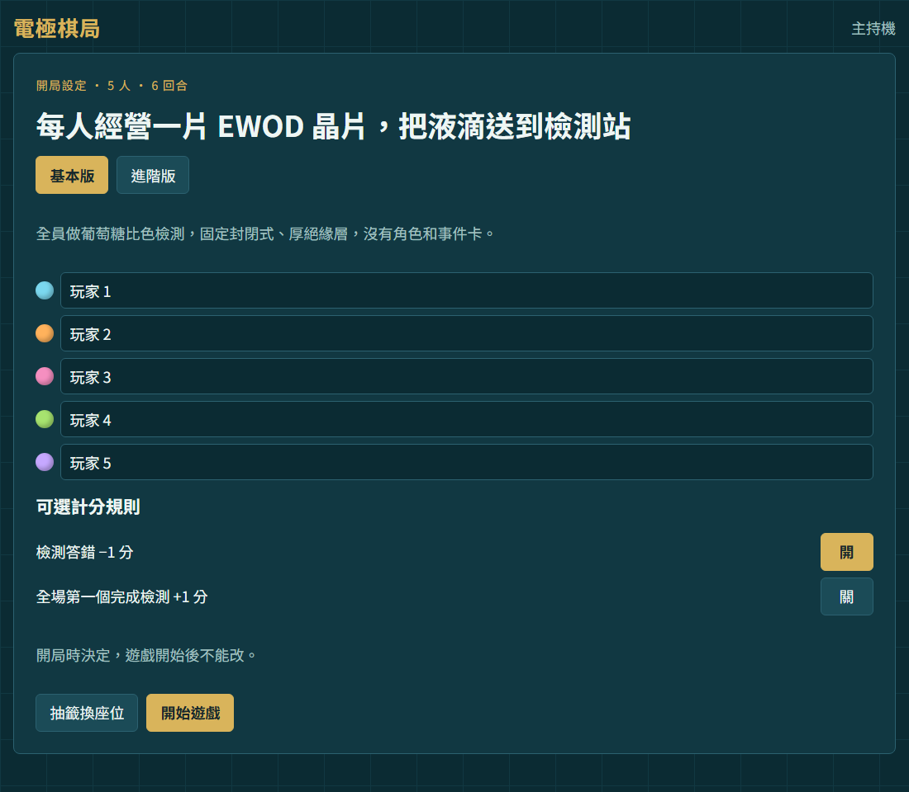

1. 選「基本版」或「進階版」。
2. 輸入 5 位玩家的姓名。左邊圓點的顏色就是起點顏色，由上到下是起點 1 到 5。
3. 按「抽籤換座位」隨機分配起點。
4. 確認兩條可選計分規則，規則說明見[計分](#計分)。
5. 按「開始遊戲」。開局電荷會自動算好。基本版各起點路線只差 1 格，每人開局都是 7 電荷，不需要補償；進階版路線較遠的起點會多拿電荷。

每人把棋子放到自己的起點，拿好同色答題旗。

## 每回合流程

### 1. 回合開始

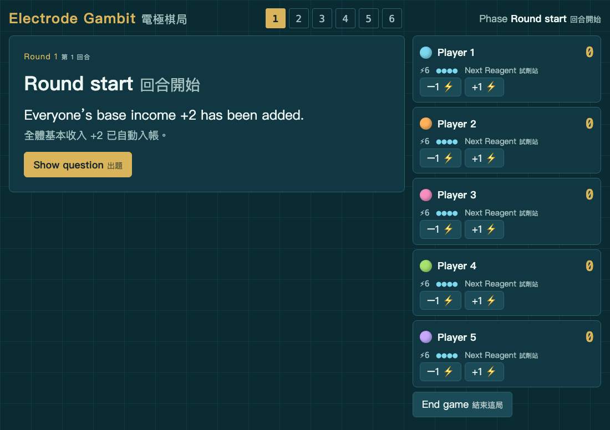

基本收入已自動入帳。右側計分板會顯示每人的分數（右上）、電荷（⚡）、絕緣層（●）和下一站。

這個畫面可以用「−1 ⚡」「+1 ⚡」修正電荷，例如剛才按錯，或要處理桌上擲骰的事件。按「出題」進入下一步。

### 2. 共同題

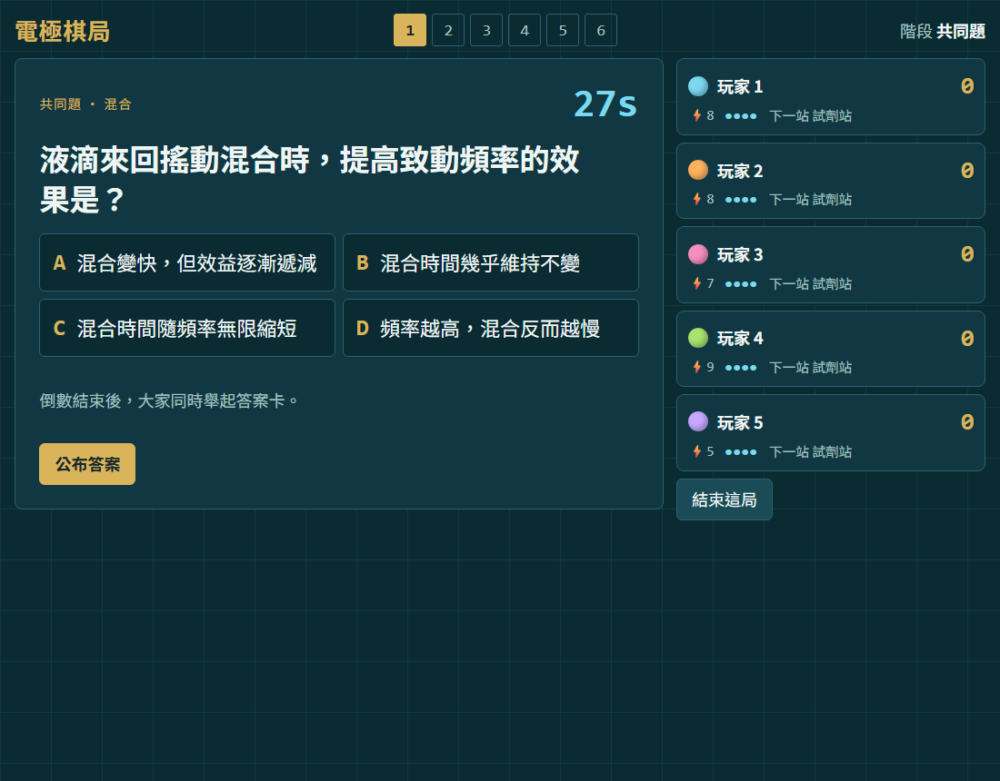

主持人念題，玩家在倒數內想好答案。時間到就同時把答題旗放到答題板上，主持人按「公布答案」。倒數只是提醒，時間到不會自動跳下一步。

### 3. 對答案

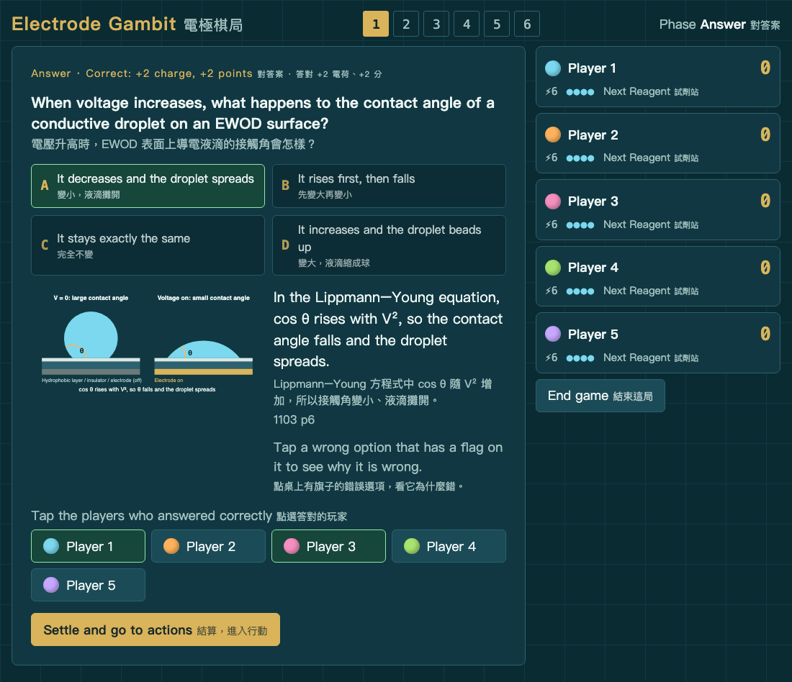

正解會標亮，並顯示解說和講義頁碼。點選答對的玩家，再按「結算，進入行動」。

點開錯誤選項可以看為什麼錯；有影片的題目會多一顆「Watch the video」按鈕。目前有五支（英文，直式），前 5 回合的英文題都有：

- [電壓怎麼改變液滴形狀](https://weipingwang1995.github.io/biomicrofluidic-board-game/videos/contact-angle.mp4)（1:18，L8-01）
- [崩潰電壓怎麼毀掉電潤濕](https://weipingwang1995.github.io/biomicrofluidic-board-game/videos/dielectric-breakdown.mp4)（1:19，L8-07）
- [電潤濕怎麼推動液滴](https://weipingwang1995.github.io/biomicrofluidic-board-game/videos/droplet-moving.mp4)（1:22，L8-15）
- [液滴怎麼切成兩顆](https://weipingwang1995.github.io/biomicrofluidic-board-game/videos/droplet-splitting.mp4)（1:08，L8-17）
- [折疊路徑為什麼混得快](https://weipingwang1995.github.io/biomicrofluidic-board-game/videos/folding-mixing.mp4)（1:36，L8-23）

全部影片也整理在[原理短片頁](https://weipingwang1995.github.io/biomicrofluidic-board-game/videos.html)，玩家可以自己用手機看。

### 4. 行動

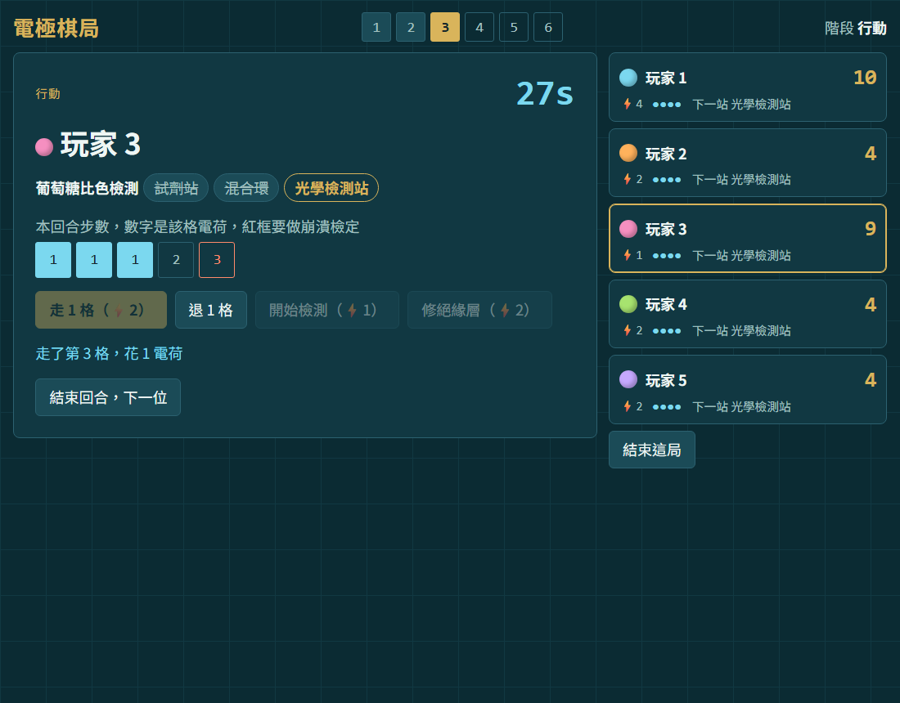

畫面會顯示輪到誰、任務進度和剩餘步數。玩家說要怎麼走，主持人照著按：

| 玩家在桌上做的事 | 主持人要按 | 說明 |
|---|---|---|
| 棋子上下左右走 1 格 | 走 1 格 | 每走 1 格按 1 次，一回合最多 5 格。液滴不能停在別人所在的格子，可以經過；站點可以重疊。厚絕緣層電荷依序花 1、1、1、2、3，按鈕上會顯示當次費用 |
| 想反悔 | 退 1 格 | 退回 1 格並還電荷 |
| 棋子已在下一站 | 完成○○站 | 花 2 電荷得 2 分，每回合最多完成 1 站 |
| 棋子已在光學檢測站 | 開始檢測 | 花 1 電荷，進入檢測題 |
| 想補絕緣層 | 修絕緣層 | 花 2 電荷恢復 1 點，製程工程師只花 1 電荷 |
| 這回合做完了 | 結束回合，下一位 | 換下一位玩家 |

> **主持人要自己看棋盤。** 主持機不會檢查棋子有沒有走到站點，所以按「完成」或「開始檢測」前，請先確認棋子真的到了。

**崩潰檢定**：畫面上紅框的格子要檢定，走到時主持機會自動擲骰，每回合走到都要重新檢定。擲出 1 或 2 會扣 1 點絕緣層，但這一格照樣走完。絕緣層歸零時，下回合暫停一次，並恢復 1 點。基本版只有第 5 格要檢定。

### 5. 檢測題

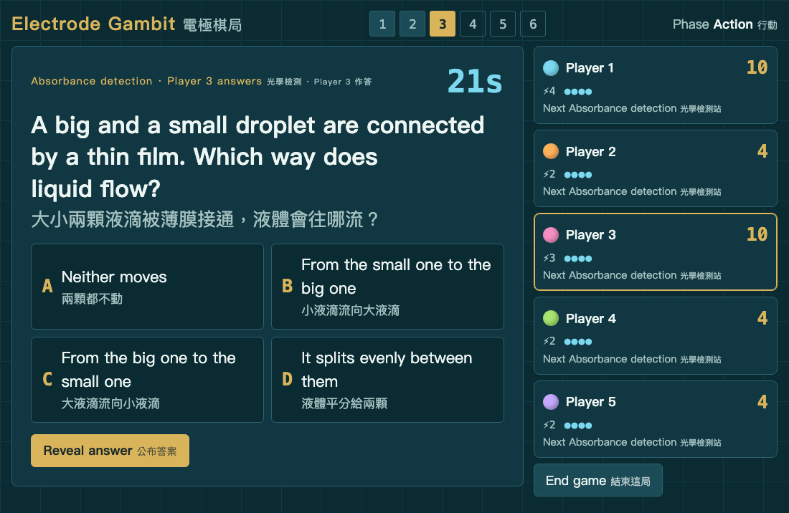

只有輪到的玩家要答，倒數 25 秒。主持人按「公布答案」，再按「答對」或「答錯」。

- **答對**：得 4 分，任務完成。基本版從目前位置再做一次同一張任務，進階版換下一張。
- **答錯**：電荷不退，下回合可以再付 1 電荷重試。基本版預設再扣 1 分。

## 遊戲結束

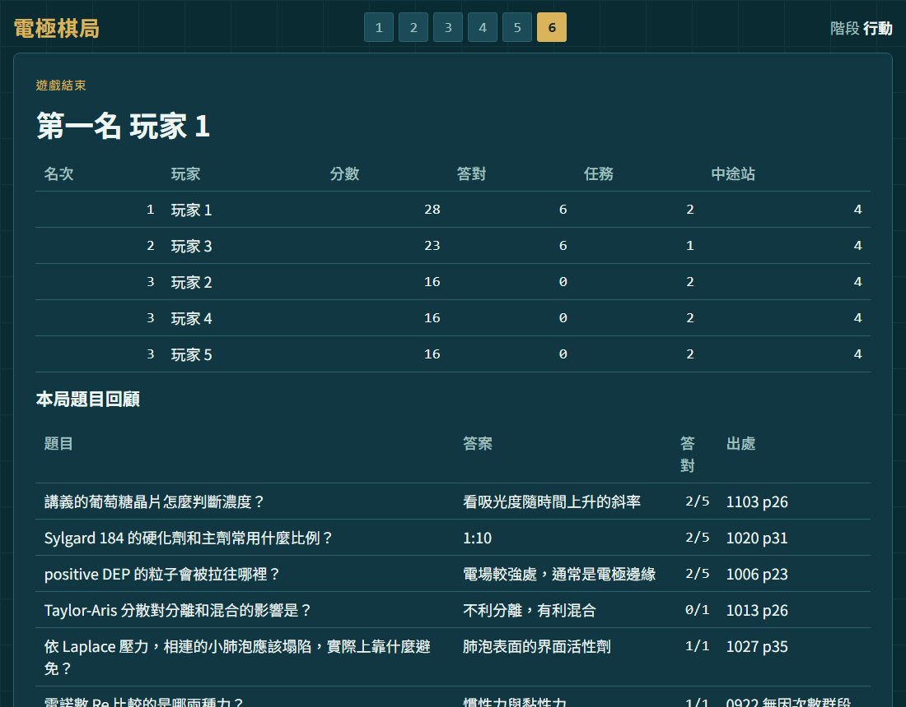

第 6 回合結束後會顯示排名，以及這局每一題的答案、答對人數和講義頁碼，可以直接拿來檢討。按「再開一局」回到開局畫面。想提早結束，可按右側的「結束這局」。

## 計分

| 項目 | 得分 |
|---|---|
| 共同題答對 | +2 |
| 完成中途站 | +2 |
| 完成檢測 | +4 |

開局畫面有兩條可選規則，遊戲開始後不能改：

| 可選規則 | 基本版預設 | 進階版預設 |
|---|---|---|
| 檢測答錯 −1 分 | 開 | 關 |
| 全場第一個完成檢測 +1 分 | 關 | 開 |

基本版同分時並列第一，想分勝負可由主持人加賽一題搶答。進階版同分時比答對題數。

## 常見狀況

| 狀況 | 怎麼處理 |
|---|---|
| 不小心多走一格 | 同一位玩家的回合內按「退 1 格」 |
| 電荷記錯 | 等下一回合的「回合開始」畫面，用 ±1 電荷修正 |
| 「走 1 格」按不下去 | 電荷不夠，或這回合已走滿 |
| 「完成站點」按不下去 | 電荷不夠，或這回合已完成過一站 |
| 手機沒電或壞掉 | 用備援題本念題，事件卡抽實體卡，電荷和分數改用紙筆記 |

## 開發者資訊

### 檔案

- `js/game-data.js`：棋盤、站點、任務、角色、晶片、事件與規則數值。改規則從這裡開始。
- `js/questions.js`：題庫，`a[0]` 是正解，顯示時會打亂。
- `js/engine.js`：規則引擎。`js/app.js`：主持機畫面。
- `print/prototype.html`：印刷稿原始檔，用瀏覽器列印成 PDF。
- `docs/images/`：這份說明的截圖。
- `videos/`、`videos.html`：原理短片（NotebookLM 產生）與給玩家的影片清單。
- `TODO.md`：待修清單。

### 檢查

- `node tools/test-engine.js`：規則測試。
- `node tools/validate-questions.js`：題庫格式檢查。
- `node tools/simulate.js 20000 0.6 basic`：機器人對局，看基本版平衡；最後改成 `full` 看進階版。
- `tools/smoke.html`：開啟後自動按完一局基本版；網址加 `?mode=full` 測進階版。
- `tools/seat-analysis.js`：比較座位公平與同分的各種規則變體。

### 棋盤平衡

`tools/layout-search.js` 用來搜尋站點和起點的位置。混合環固定在正中央，試劑站和分裂站在中央區，電泳站、介電泳站和光學檢測站靠近邊緣；在這個前提下，讓每張任務的 5 個起點路線盡量一樣長。

| 任務 | 起點 1 | 起點 2 | 起點 3 | 起點 4 | 起點 5 |
|---|---|---|---|---|---|
| 葡萄糖比色檢測 | 12 | 13 | 12 | 12 | 13 |
| 電泳濃縮 | 10 | 9 | 10 | 12 | 9 |
| 帶電粒子分離 | 12 | 13 | 14 | 14 | 11 |
| DEP 細胞分選 | 12 | 9 | 12 | 10 | 11 |
| 粒子標定 | 14 | 11 | 14 | 12 | 13 |
| 樣品稀釋 | 12 | 13 | 12 | 12 | 13 |

### 題庫來源

1103 的題目已對照講義逐頁確認；其他週來自課堂筆記，尚未全部回頭核對講義，使用前請先審題。
